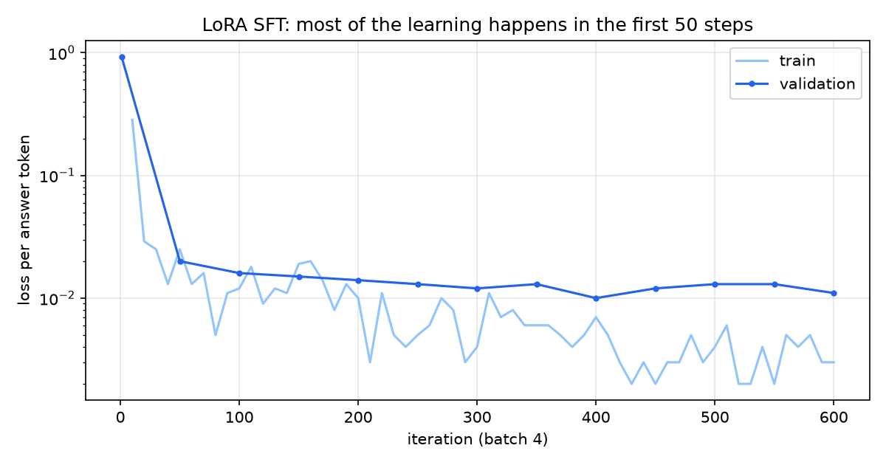
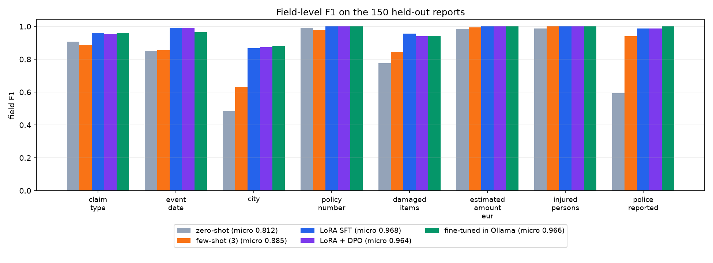
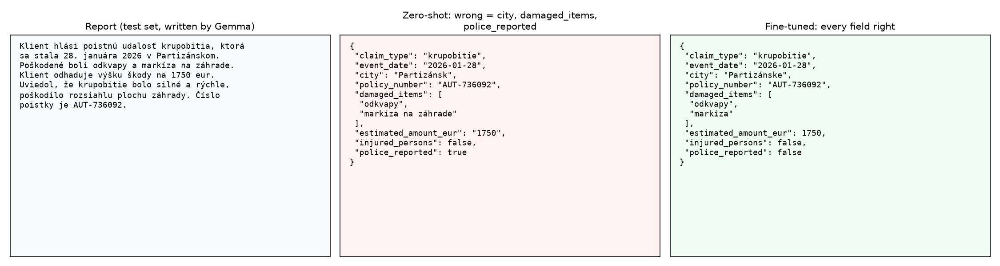
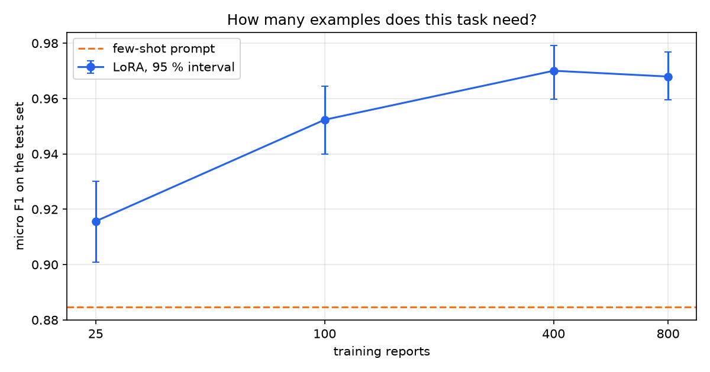

# 13 · Fine-tuning a small model to read Slovak claims: LoRA vs DPO

🇸🇰 [Slovenská verzia](README.sk.md)

## TL;DR
- A 1.7B model turns Slovak insurance reports into JSON. Fine-tuned with LoRA it reaches **micro F1 0.968** on 150 held-out reports, against **0.812** zero-shot and **0.885** with a 3-example prompt.
- Valid JSON goes from **24.0 %** zero-shot to **100 %** in Ollama, and the fine-tuned model is the fastest system there: **0.83 s** per report against 1.02 s, at the same 4-bit quantisation.
- **25 examples already beat the few-shot prompt** (0.916 vs 0.885). The curve flattens around 400 reports (0.970).
- **DPO added nothing measurable** (0.964 vs 0.968, inside the noise). The SFT model made so few mistakes that 389 of 400 "bad answers" had to be synthetic.
- The weakest field is the city. On towns seen in training it gets 97 of 99 right, on new towns 22 of 36, so part of the gain is memorised.

## Start here
Imagine a report saying: “Hail damaged my roof in Žilina; repairs will cost about €1,950.” A program should extract fields into a fixed **JSON** format, such as city, claim type, and amount as a number. Another system can then store or process them. The challenge is that a general language model sometimes returns the wrong format or the wrong field.

The project compares four approaches on the same task: an instruction without examples, an instruction with three examples, **LoRA** fine-tuning, and an additional **DPO** step. The data is synthetic: correct records are created first, then Slovak reports are written from them. With LoRA most model weights stay frozen and only a small part is trained. **F1** measures agreement between extracted fields and correct answers; higher is better.

On 150 held-out reports, micro F1 rises from 0.812 without examples to 0.968 after LoRA. DPO brings no measurable further improvement. Plots show how the result changes with the number of training examples and which fields remain difficult. These results describe this synthetic dataset; real-world use would require evaluation on real reports.

## Problem
Can a model small enough for a laptop reliably pull structured data out of messy Slovak text, and is fine-tuning the right tool for that? This step answers the roadmap's question with a table: zero-shot vs few-shot vs LoRA vs LoRA + DPO, same test set, same metrics.

**Prompt, RAG or fine-tune?** The three fix different problems, so the order matters:

| Symptom | Try | Why |
|---|---|---|
| The model can do it, but needs telling how | **Prompt**, then a few examples | Costs nothing, changes in a minute |
| The model lacks facts that change or are private | **RAG** | Facts belong in a document store, not in weights: you can update and cite them |
| The model knows enough, but the **behaviour** is unreliable (format, conventions, a narrow task at high volume) | **Fine-tune** | Behaviour is what weights are good at holding |

This task is the third case. Nothing here needs outside knowledge: every answer is in the report. The failure is behavioural, as the baselines show: a correct amount written as the string `"1950"` instead of a number, a town left in the wrong grammatical case.

No Racing Lab chapter: fine-tuning is about language behaviour, and a car has no text to read. The visual example is the before/after panel below.

## Setup
- **Schema (fixed up front):** `claim_type` (7 values), `event_date`, `city`, `policy_number`, `damaged_items`, `estimated_amount_eur`, `injured_persons`, `police_reported`.
- **Student:** Qwen3-1.7B. `mlx-community/Qwen3-1.7B-bf16` for training, `qwen3:1.7b` in Ollama (the same model at Q4_K_M), thinking off, temperature 0.
- **Hardware:** Mac mini M4 Pro, 48 GB, MLX on the GPU. All local, 0 €.
- **Data:** 800 train, 100 val, 150 test synthetic reports with ground truth by construction (below).
- **Metrics:** valid JSON means it parses and every field has the right type. Micro precision, recall and F1 over fields, lists compared as sets of normalised items, amounts within 1 %, dates exact, bootstrap 95 % interval over documents. Median latency per report.

## How it works

**Ground truth by construction (`schema.py`, `generate_data.py`).** The record comes first: Python samples it with a fixed seed, and only then does a local model write a report with exactly those facts, in one of six styles, some fields missing. The label cannot be wrong unless the writer disobeys.

**Keeping the test set honest.** Three separate defences:
- Train and val are written by `qwen3:30b-a3b`, test by `gemma3:12b`, so the student cannot score by recognising one writer's style.
- Records are split by seed before any text exists. No report text and no policy number appears in both train and test.
- 10 towns appear only in test (36 of the 150 test reports), so a list of towns from training is not enough.

**A consistency check, then reading.** Every non-null value must appear in the text in some form, and null values must stay out. Of 1,040 / 140 / 260 written reports, 816 / 106 / 174 passed. The first version wrongly failed correct dates like "osemnásteho februára", which I fixed before any model saw the data.

Claude then read every 10th report by hand, 105 in total; I did not. That found two kinds of wrong label the check had missed: a date the writer invented while the record said null (14 reports once the check knew to look), and a date without a year where the label still had one (29 in train, 5 in val, 11 in test). Both became automatic checks, the sets were rebuilt, and the baselines were restarted. Reading found things a regex I wrote could not.

**One prompt for all.** `common.py` holds the system prompt and the scoring, so every row of the results table is judged by the same code. Few-shot adds 3 training reports, chosen by seed before any result existed.

**LoRA (`train_sft.py`).** Most of the model stays frozen; each adapted layer learns a small update of rank 8, here in the last 16 layers: 4.98M trainable weights out of 1,720M, or 0.289 %. `--mask-prompt` means loss is counted only on the answer, because the report is context and not something to reproduce. Rank 8, scale 2.0, learning rate 1e-4, batch 4, 600 iterations.



Validation loss falls from 0.930 to 0.020 in the first 50 steps, and ends at 0.011.

**DPO (`train_dpo.py`).** Supervised training only says "this is right". DPO says "this is better than that": it raises the probability of the chosen answer relative to the rejected one, compared with a frozen reference, here the SFT adapter. The plan was to use the SFT model's own mistakes as rejected answers. It made only 11 mistakes on 400 training reports, so the other 389 pairs use systematic corruptions: a wrong category, a dropped item, a flipped yes/no, a lost value. Tool: `DPOTrainer` from mlx-tune 0.6.0, beta 0.1, learning rate 1e-5, 150 steps, batch 2. Batch 1 crashes in its shared-prompt cache path with this MLX version.

**Choosing without touching test.** The adapter was picked on val: the higher F1 if the 95 % intervals do not overlap, otherwise the simpler model. They overlap (SFT 0.982, DPO 0.984), so plain LoRA went on.

**Into Ollama (`fuse.sh`).** The adapter is fused into the weights, which is less simple than it sounds. Ollama rejects Qwen3 safetensors (`unsupported architecture "Qwen3ForCausalLM"`) and `mlx_lm` has no GGUF export for it, so llama.cpp's converter makes the GGUF and Ollama quantises that to Q4_K_M. The result runs as `claims-sk`, 1.1 GB.

## Results

| System | Runtime | Precision | Recall | **Micro F1** (95 % interval) | Valid JSON | Median latency |
|---|---|---|---|---|---|---|
| Zero-shot | Ollama, Q4 | 0.796 | 0.830 | 0.812 (0.790–0.835) | 24.0 % | 1.02 s |
| Few-shot, 3 examples | Ollama, Q4 | 0.865 | 0.905 | 0.885 (0.865–0.904) | 87.3 % | 1.05 s |
| LoRA SFT | MLX, bf16 | 0.969 | 0.967 | **0.968** (0.959–0.977) | 99.3 % | 2.03 s |
| LoRA + DPO | MLX, bf16 | 0.966 | 0.963 | 0.964 (0.955–0.974) | 99.3 % | 1.99 s |
| **LoRA SFT, fused** | **Ollama, Q4** | 0.964 | 0.968 | **0.966** (0.955–0.975) | **100 %** | **0.83 s** |

Only the Ollama rows have comparable latency. The MLX rows run a larger, unquantised model in a different runtime. The fine-tuned model is faster than the baselines in Ollama; all 150 of its answers are on one line against 12 for zero-shot, and shorter on average (222 vs 244 characters), which is a likely reason, though I did not time it separately. 4-bit quantisation cost almost nothing (0.968 → 0.966).



The same report, before and after:



**How many examples?** The same recipe on the first N reports, 300 iterations each:

| Training reports | Micro F1 (95 % interval) | Valid JSON |
|---|---|---|
| 25 | 0.916 (0.901–0.930) | 100 % |
| 100 | 0.952 (0.940–0.964) | 99.3 % |
| 400 | 0.970 (0.960–0.979) | 100 % |
| 800 (600 iterations) | 0.968 (0.959–0.977) | 99.3 % |



Doubling from 400 to 800 bought nothing here. The 800 row had twice the iterations, so this curve answers "how much data", not "how much training".

**Did it forget the rest?** Eight general Slovak questions, no system prompt, base vs fine-tuned. Neither answered with JSON, which is the failure this check is looking for. A keyword score gives 6 of 8 vs 7 of 8, but it is crude: it counts the leap-year answer as right for both models, which both give as 365. The base model is already poor at Slovak facts (its capital of Slovakia was wrong, the tuned one's right). So there is no sign of forgetting in these 8 questions, and 8 questions cannot show much more than that.

## Error analysis
On the fine-tuned model in Ollama, 110 of 150 reports have every field right. Errors by reports affected: `damaged_items` 19, `city` 16, `claim_type` 6, `event_date` 4. Policy number, amount, injuries and police are perfect.

- **City, new towns.** 97 of 99 right on towns from training, 22 of 36 on new ones. 13 of the 16 misses keep the right word in the wrong form or a slip of it: "Brezne" for Brezno, "Galante" for Galanta, "Levica" for Levice. Turning a Slovak locative back into a nominative needs knowing the town. Zero-shot missed the city in 74 reports, so this is still a big gain, but the test-only towns show how much of it depends on having seen the name.
- **Damaged items.** Often the model is more precise than the label: "ľavý predný blatník" for "blatník", "detská kolobežka" for "kolobežka". My scorer counts these as wrong. A few are real, such as listing one item out of three.
- **Claim type.** 5 of 6 errors are gold `iné` ("other"). When the record says "other", the writer still has to invent a cause, and a fire-sounding story labelled `iné` is a fair thing to get wrong. This is noise in the data as much as a model error.
- **Dates.** All 4 errors in Ollama are on day 9, three of them read as day 10. The unquantised model made 1 error on this field, so this looks like a side effect of quantisation, though 4 cases cannot prove that.
- **DPO.** It changed 10 of 150 outputs, and moved weights by about 7 % of their mean size. Its losses and gains cancel out inside the interval.

Differences among the three fine-tuned rows are inside the noise. The differences between them and the baselines are not.

## What I learned
- Fine-tuning is at its best on behaviour. Copying a value out of the text was nearly solved already; the gain is in the format and in conventions.
- Before reaching for more data, measure how little will do. 25 examples beat my best prompt here, and that is an evening of work.
- DPO needs real mistakes to work on. A model that is nearly right has nothing to learn from synthetic corruptions it would never make, so preference tuning belongs to subjective qualities like tone, more than to a task with one correct answer.
- Automatic checks only find what you thought of. Reading 105 reports found errors in the labels that my own check had passed, and fixing them changed every number here.
- A score can look better than the thing it measures: the keyword forgetting check counted a wrong answer as right. Look at the outputs.
- The real work of shipping was at the end: three tools had to cooperate to get one model into Ollama.

## Run it
```bash
uv sync
nohup caffeinate -i sh pipeline.sh > logs/pipeline.log 2>&1 &   # data, baselines, LoRA, DPO; resumes after a stop
uv run python eval_mlx.py val_lora --adapter adapters/sft --split val
uv run python eval_mlx.py val_lora_dpo --adapter adapters/dpo --split val
LLAMA_CPP=/path/to/llama.cpp sh fuse.sh                         # fuse and create claims-sk in Ollama
uv run python eval_ollama.py ollama_finetuned --model claims-sk
uv run python forgetting.py
uv run python learning_curve.py                                 # about 45 minutes
uv run python analysis.py && uv run python plot.py
```

Needs Ollama with `qwen3:1.7b`, `gemma3:12b` and `qwen3:30b-a3b-instruct-2507-q4_K_M`. Data, adapters and models are not in the repo. `results_best.json` records the val choice, which is written by hand from the two `val_*` results.

## Limitations
- **The data is synthetic.** Written by LLMs, with weak Slovak grammar in places ("Poistná číslo") and some stiff phrasing. Real claims have typos, attachments and contradictions. Expect worse numbers on real text; this measures the method, not a product.
- **The records are independent draws**, so a 29,800 € headlight happens. The model never needs to judge plausibility.
- **Reports the check rejected are gone**, so the test set is a little easier than what the writers produced, for example amounts spelled out in words.
- **One LoRA run, one seed.** The intervals cover the choice of documents, not training randomness.
- **The DPO row tests one recipe**, mostly on synthetic rejected answers, after an already accurate SFT stage. It says little about DPO on tasks where people disagree about what is better.
- **Hand reading was done by Claude, once, for 105 reports.** Errors it did not notice are still in the data.
- The test set influenced one thing indirectly: the scorer treats item variants strictly, and the analysis above suggests the true item F1 is a little higher. I left it strict rather than tune the metric after seeing results.
