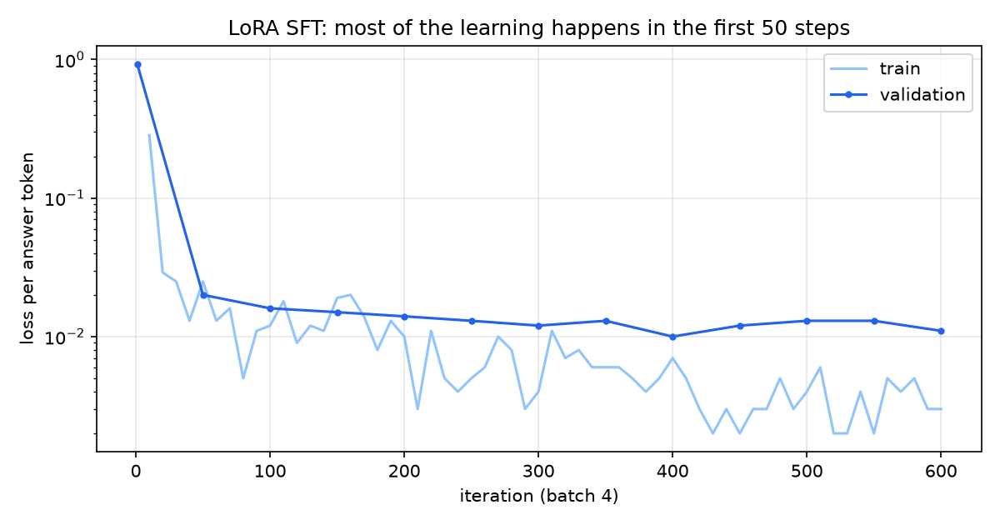
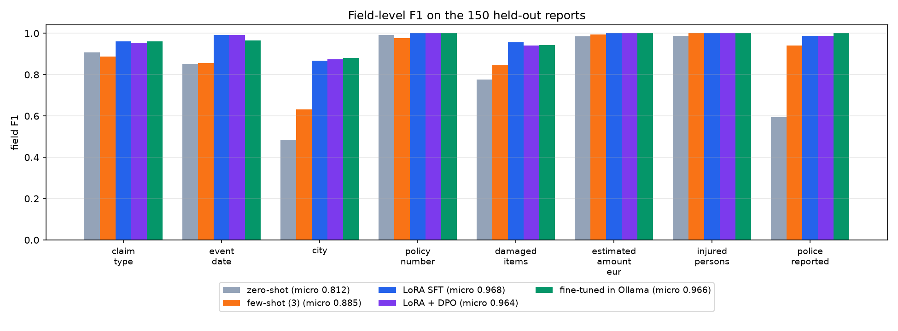
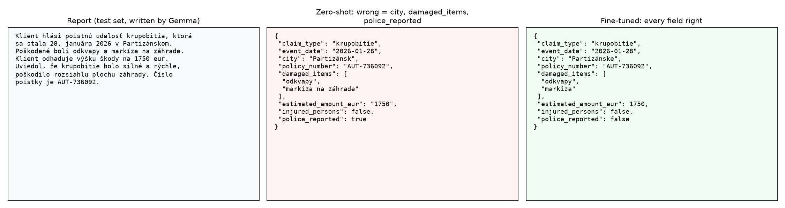
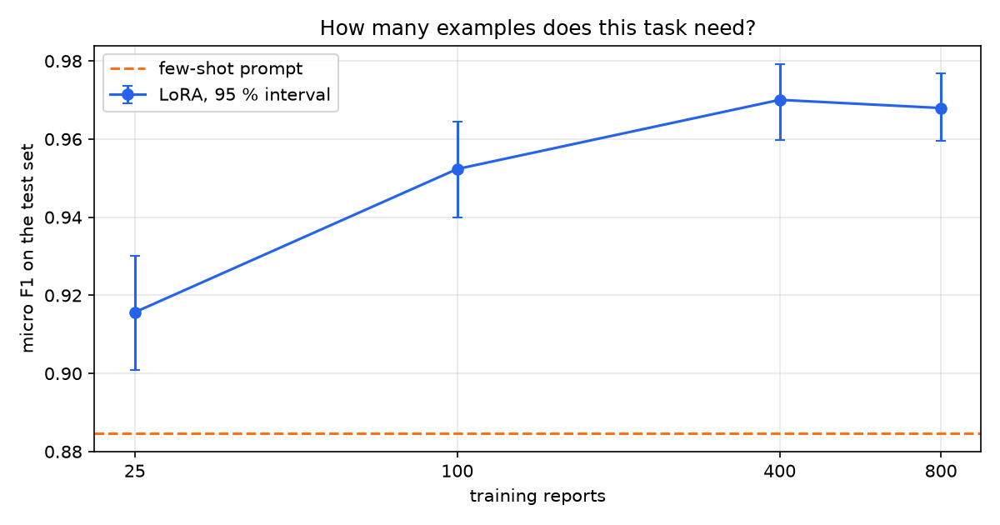

# 13 · Doladenie malého modelu na čítanie slovenských hlásení: LoRA vs DPO

🇬🇧 [English version](README.md)

## TL;DR
- Model s 1,7B parametrov mení slovenské poistné hlásenia na JSON. Doladený cez LoRA dosahuje **micro F1 0,968** na 150 odložených hláseniach, oproti **0,812** bez príkladov (zero-shot) a **0,885** s promptom s 3 príkladmi.
- Platný JSON stúpne z **24,0 %** pri zero-shot na **100 %** v Ollame a doladený model je tam najrýchlejší: **0,83 s** na hlásenie oproti 1,02 s, pri rovnakej 4-bitovej kvantizácii.
- **Už 25 príkladov porazí few-shot prompt** (0,916 vs 0,885). Krivka sa vyrovná okolo 400 hlásení (0,970).
- **DPO nepridalo nič merateľné** (0,964 vs 0,968, v rámci šumu). Model po SFT robil tak málo chýb, že 389 zo 400 „zlých odpovedí“ muselo byť syntetických.
- Najslabšie pole je mesto. Na mestách z tréningu má 97 z 99 správne, na nových 22 z 36, takže časť zlepšenia je zapamätaná.

## Najprv jednoducho
Predstav si hlásenie: „V Žiline mi krúpy poškodili strechu, oprava stojí asi 1 950 €.“ Program má z neho vytiahnuť údaje do pevného formátu **JSON**, napríklad mesto, druh škody a sumu ako číslo. To uľahčuje ďalšiemu systému údaje uložiť alebo spracovať. Problém je, že všeobecný jazykový model niekedy vráti nesprávny formát alebo nesprávne pole.

Projekt porovná štyri možnosti na rovnakej úlohe: pokyn bez príkladu, pokyn s tromi príkladmi, **LoRA** doladenie a ďalší krok **DPO**. Dáta sú syntetické: najprv sa vytvoria správne záznamy, potom sa z nich napíšu slovenské hlásenia. Pri LoRA ostáva väčšina modelu zmrazená a učí sa len malá časť váh. **F1** meria zhodu vyťažených polí so správnymi odpoveďami; vyššie je lepšie.

Na 150 odložených hláseniach stúplo micro F1 z 0,812 bez príkladov na 0,968 po LoRA. DPO už neprinieslo merateľné zlepšenie. Grafy ukazujú, ako sa výsledok mení s počtom tréningových príkladov a pri ktorých poliach model stále chybuje. Výsledok opisuje tento syntetický dataset; pred reálnym použitím by bolo treba overenie na skutočných hláseniach.

## Problem
Dokáže model taký malý, že beží na notebooku, spoľahlivo vytiahnuť štruktúrované údaje z neupraveného slovenského textu, a je na to doladenie správny nástroj? Tento krok odpovedá na otázku roadmapy tabuľkou: zero-shot vs few-shot vs LoRA vs LoRA + DPO, rovnaká testovacia sada, rovnaké metriky.

**Prompt, RAG alebo doladenie?** Každé rieši iný problém, preto záleží na poradí:

| Príznak | Skús | Prečo |
|---|---|---|
| Model to vie, ale treba mu povedať ako | **Prompt**, potom pár príkladov | Nestojí nič, zmení sa za minútu |
| Modelu chýbajú fakty, ktoré sa menia alebo sú súkromné | **RAG** | Fakty patria do úložiska dokumentov, nie do váh: dajú sa aktualizovať a citovať |
| Model vie dosť, ale **správanie** je nespoľahlivé (formát, konvencie, úzka úloha vo veľkom objeme) | **Doladenie** | Správanie je presne to, čo si váhy vedia udržať |

Táto úloha je tretí prípad. Nič tu nepotrebuje vonkajšie znalosti: každá odpoveď je v hlásení. Zlyhanie je v správaní, ako ukazujú baseline systémy: správna suma zapísaná ako reťazec `"1950"` namiesto čísla, mesto ponechané v zlom páde.

Bez kapitoly v Racing Labe: doladenie je o jazykovom správaní a auto nemá čo čítať. Vizuálny príklad je panel pred/po nižšie.

## Setup
- **Schéma (pevná vopred):** `claim_type` (7 hodnôt), `event_date`, `city`, `policy_number`, `damaged_items`, `estimated_amount_eur`, `injured_persons`, `police_reported`.
- **Študent:** Qwen3-1.7B. `mlx-community/Qwen3-1.7B-bf16` na tréning, `qwen3:1.7b` v Ollame (ten istý model v Q4_K_M), bez premýšľania, teplota 0.
- **Hardvér:** Mac mini M4 Pro, 48 GB, MLX na GPU. Všetko lokálne, 0 €.
- **Dáta:** 800 train, 100 val, 150 test syntetických hlásení so správnou odpoveďou danou konštrukciou (nižšie).
- **Metriky:** platný JSON znamená, že sa dá načítať a každé pole má správny typ. Micro precision, recall a F1 cez polia, zoznamy sa porovnávajú ako množiny normalizovaných položiek, sumy s toleranciou 1 %, dátumy presne, bootstrap 95 % interval cez dokumenty. Medián latencie na hlásenie.

## How it works

**Správna odpoveď konštrukciou (`schema.py`, `generate_data.py`).** Najprv vznikne záznam: Python ho vyžrebuje s pevným seedom a až potom lokálny model napíše hlásenie presne s týmito faktami, v jednom zo šiestich štýlov, niektoré polia chýbajú. Označenie nemôže byť zlé, pokiaľ pisateľ neposlúchne.

**Ako udržať testovaciu sadu poctivú.** Tri samostatné poistky:
- Train a val píše `qwen3:30b-a3b`, test `gemma3:12b`, takže študent nemôže skórovať rozpoznaním štýlu jedného pisateľa.
- Záznamy sa rozdelia podľa seedu skôr, než existuje akýkoľvek text. Žiadny text hlásenia ani číslo poistky nie je v train aj test zároveň.
- 10 miest je iba v teste (36 zo 150 testovacích hlásení), takže zoznam miest z tréningu nestačí.

**Automatická kontrola, potom čítanie.** Každá nenulová hodnota sa musí v texte v nejakej forme objaviť a prázdne hodnoty v ňom byť nesmú. Z 1 040 / 140 / 260 napísaných hlásení prešlo 816 / 106 / 174. Prvá verzia chybne odmietala správne dátumy ako „osemnásteho februára“, čo som opravil skôr, než dáta videl akýkoľvek model.

Potom Claude ručne prečítal každé 10. hlásenie, spolu 105; ja nie. Našli sa tak dva druhy zlých označení, ktoré kontrola prehliadla: dátum, ktorý si pisateľ vymyslel, hoci záznam mal null (14 hlásení, keď už kontrola vedela, čo hľadať), a dátum bez roka, hoci označenie rok malo (29 v train, 5 vo val, 11 v teste). Oba sa stali automatickými kontrolami, sady sa znova zostavili a baseline systémy sa spustili odznova. Čítanie našlo to, čo regex, ktorý som napísal, nájsť nemohol.

**Jeden prompt pre všetkých.** `common.py` drží systémový prompt aj hodnotenie, takže každý riadok tabuľky výsledkov posudzuje ten istý kód. Few-shot pridáva 3 tréningové hlásenia, vybrané seedom skôr, než existoval akýkoľvek výsledok.

**LoRA (`train_sft.py`).** Väčšina modelu ostáva zmrazená; každá doladená vrstva sa učí malú zmenu s rankom 8, tu v posledných 16 vrstvách: 4,98M trénovateľných váh z 1 720M, teda 0,289 %. `--mask-prompt` znamená, že loss sa počíta len na odpovedi, lebo hlásenie je kontext, nie niečo, čo treba zopakovať. Rank 8, scale 2,0, learning rate 1e-4, batch 4, 600 iterácií.



Validačná loss klesne z 0,930 na 0,020 za prvých 50 krokov a skončí na 0,011.

**DPO (`train_dpo.py`).** Doladenie s učiteľom hovorí len „toto je správne“. DPO hovorí „toto je lepšie ako tamto“: zvyšuje pravdepodobnosť zvolenej odpovede voči odmietnutej v porovnaní so zmrazeným referenčným modelom, tu adaptérom zo SFT. Plán bol použiť ako odmietnuté odpovede vlastné chyby SFT modelu. Na 400 tréningových hláseniach ich urobil len 11, takže zvyšných 389 párov používa systematické pokazenia: zlá kategória, vypadnutá položka, otočené áno/nie, stratená hodnota. Nástroj: `DPOTrainer` z mlx-tune 0.6.0, beta 0,1, learning rate 1e-5, 150 krokov, batch 2. Batch 1 padá v jeho ceste so zdieľanou cache promptu pri tejto verzii MLX.

**Výber bez dotyku testu.** Adaptér sa vyberal na val: vyššie F1, ak sa 95 % intervaly neprekrývajú, inak jednoduchší model. Prekrývajú sa (SFT 0,982, DPO 0,984), takže ďalej išla čistá LoRA.

**Do Ollamy (`fuse.sh`).** Adaptér sa vtaví do váh, čo je menej jednoduché, než to znie. Ollama odmietne Qwen3 safetensors (`unsupported architecture "Qwen3ForCausalLM"`) a `mlx_lm` preň nemá export do GGUF, takže GGUF vyrobí konvertor z llama.cpp a Ollama ho kvantizuje na Q4_K_M. Výsledok beží ako `claims-sk`, 1,1 GB.

## Results

| Systém | Runtime | Precision | Recall | **Micro F1** (95 % interval) | Platný JSON | Medián latencie |
|---|---|---|---|---|---|---|
| Zero-shot | Ollama, Q4 | 0,796 | 0,830 | 0,812 (0,790–0,835) | 24,0 % | 1,02 s |
| Few-shot, 3 príklady | Ollama, Q4 | 0,865 | 0,905 | 0,885 (0,865–0,904) | 87,3 % | 1,05 s |
| LoRA SFT | MLX, bf16 | 0,969 | 0,967 | **0,968** (0,959–0,977) | 99,3 % | 2,03 s |
| LoRA + DPO | MLX, bf16 | 0,966 | 0,963 | 0,964 (0,955–0,974) | 99,3 % | 1,99 s |
| **LoRA SFT, vtavená** | **Ollama, Q4** | 0,964 | 0,968 | **0,966** (0,955–0,975) | **100 %** | **0,83 s** |

Porovnateľnú latenciu majú len riadky z Ollamy. Riadky z MLX bežia na väčšom, nekvantizovanom modeli v inom runtime. Doladený model je v Ollame rýchlejší než baseline systémy; všetkých 150 jeho odpovedí je na jednom riadku oproti 12 pri zero-shot a v priemere sú kratšie (222 vs 244 znakov), čo je pravdepodobný dôvod, hoci som to samostatne nemeral. 4-bitová kvantizácia nestála takmer nič (0,968 → 0,966).



To isté hlásenie pred a po:



**Koľko príkladov treba?** Rovnaký postup na prvých N hláseniach, po 300 iterácií:

| Tréningové hlásenia | Micro F1 (95 % interval) | Platný JSON |
|---|---|---|
| 25 | 0,916 (0,901–0,930) | 100 % |
| 100 | 0,952 (0,940–0,964) | 99,3 % |
| 400 | 0,970 (0,960–0,979) | 100 % |
| 800 (600 iterácií) | 0,968 (0,959–0,977) | 99,3 % |



Zdvojnásobenie zo 400 na 800 tu neprinieslo nič. Riadok 800 mal dvakrát viac iterácií, takže táto krivka odpovedá na otázku „koľko dát“, nie „koľko tréningu“.

**Zabudol zvyšok?** Osem všeobecných slovenských otázok, bez systémového promptu, základný vs doladený model. Ani jeden neodpovedal JSON-om, a práve toto zlyhanie kontrola hľadá. Skóre podľa kľúčového slova dáva 6 z 8 vs 7 z 8, ale je hrubé: odpoveď o priestupnom roku počíta ako správnu pri oboch modeloch, hoci obe tvrdia 365. Základný model je v slovenských faktoch slabý už sám (hlavné mesto Slovenska mal zle, doladený dobre). V týchto 8 otázkach teda nie je znak zabúdania a 8 otázok viac ukázať nevie.

## Error analysis
Pri doladenom modeli v Ollame má 110 zo 150 hlásení všetky polia správne. Chyby podľa počtu zasiahnutých hlásení: `damaged_items` 19, `city` 16, `claim_type` 6, `event_date` 4. Číslo poistky, suma, zranenia a polícia sú bez chyby.

- **Mesto, nové mestá.** 97 z 99 správne na mestách z tréningu, 22 z 36 na nových. 13 zo 16 chýb nechá správne slovo v zlom tvare alebo s preklepom: „Brezne“ namiesto Brezno, „Galante“ namiesto Galanta, „Levica“ namiesto Levice. Vrátiť slovenský lokál na nominatív znamená poznať mesto. Zero-shot pomýlil mesto v 74 hláseniach, takže zlepšenie je aj tak veľké, ale mestá iba z testu ukazujú, koľko z neho závisí od toho, či model názov videl.
- **Poškodené veci.** Model je často presnejší než označenie: „ľavý predný blatník“ namiesto „blatník“, „detská kolobežka“ namiesto „kolobežka“. Moje hodnotenie to berie ako chybu. Niektoré sú však skutočné, napríklad uvedená jedna vec z troch.
- **Typ udalosti.** 5 zo 6 chýb má správnu odpoveď `iné`. Keď záznam povie „iné“, pisateľ si aj tak musí vymyslieť príčinu a príbeh znejúci ako požiar s označením `iné` je férové pomýliť. Je to rovnako šum v dátach ako chyba modelu.
- **Dátumy.** Všetky 4 chyby v Ollame sú pri dni 9, tri z nich prečítané ako deň 10. Nekvantizovaný model urobil v tomto poli 1 chybu, takže to vyzerá ako vedľajší účinok kvantizácie, ale 4 prípady to dokázať nevedia.
- **DPO.** Zmenilo 10 zo 150 výstupov a posunulo váhy asi o 7 % ich priemernej veľkosti. Jeho straty a zisky sa v rámci intervalu vyrušia.

Rozdiely medzi tromi doladenými riadkami sú v rámci šumu. Rozdiely medzi nimi a baseline systémami nie.

## What I learned
- Doladenie je najlepšie na správanie. Skopírovať hodnotu z textu vedel model už skoro bez chyby; zisk je vo formáte a v konvenciách.
- Skôr než siahneš po ďalších dátach, zmeraj, ako málo stačí. 25 príkladov tu porazilo môj najlepší prompt a to je práca na jeden večer.
- DPO potrebuje skutočné chyby. Model, ktorý má takmer všetko dobre, sa nemá čo naučiť zo syntetických pokazení, ktoré by sám nikdy neurobil, takže preferenčné ladenie patrí skôr k subjektívnym vlastnostiam, ako je tón, než k úlohe s jednou správnou odpoveďou.
- Automatické kontroly nájdu len to, na čo si pomyslel. Čítanie 105 hlásení našlo chyby v označeniach, ktoré moja vlastná kontrola pustila, a ich oprava zmenila každé číslo tu.
- Skóre môže vyzerať lepšie než vec, ktorú meria: kľúčová kontrola zabúdania započítala zlú odpoveď ako správnu. Pozri sa na výstupy.
- Skutočná práca s nasadením prišla na konci: aby sa jeden model dostal do Ollamy, museli spolupracovať tri nástroje.

## Run it
```bash
uv sync
nohup caffeinate -i sh pipeline.sh > logs/pipeline.log 2>&1 &   # dáta, baseline, LoRA, DPO; po zastavení pokračuje
uv run python eval_mlx.py val_lora --adapter adapters/sft --split val
uv run python eval_mlx.py val_lora_dpo --adapter adapters/dpo --split val
LLAMA_CPP=/cesta/k/llama.cpp sh fuse.sh                         # vtaví adaptér a vytvorí claims-sk v Ollame
uv run python eval_ollama.py ollama_finetuned --model claims-sk
uv run python forgetting.py
uv run python learning_curve.py                                 # asi 45 minút
uv run python analysis.py && uv run python plot.py
```

Treba Ollamu s `qwen3:1.7b`, `gemma3:12b` a `qwen3:30b-a3b-instruct-2507-q4_K_M`. Dáta, adaptéry a modely nie sú v repozitári. `results_best.json` zaznamenáva výber na val a píše sa ručne z dvoch výsledkov `val_*`.

## Limitations
- **Dáta sú syntetické.** Písali ich LLM, miestami so slabou slovenskou gramatikou („Poistná číslo“) a so strojenými formuláciami. Skutočné hlásenia majú preklepy, prílohy a protirečenia. Na skutočnom texte čakaj horšie čísla; toto meria metódu, nie produkt.
- **Záznamy sú nezávislé žreby**, takže sa stane aj svetlomet za 29 800 €. Model nikdy nemusí posudzovať, či je niečo vierohodné.
- **Hlásenia odmietnuté kontrolou sú preč**, takže testovacia sada je o niečo ľahšia než to, čo pisatelia vytvorili, napríklad sumy vypísané slovami.
- **Jeden beh LoRA, jeden seed.** Intervaly pokrývajú výber dokumentov, nie náhodnosť tréningu.
- **Riadok DPO testuje jeden recept**, väčšinou so syntetickými odmietnutými odpoveďami, po už presnom kroku SFT. O DPO na úlohách, kde sa ľudia nezhodnú, čo je lepšie, hovorí málo.
- **Ručné čítanie robil Claude, raz, na 105 hláseniach.** Chyby, ktoré si nevšimol, v dátach ostali.
- Testovacia sada nepriamo ovplyvnila jednu vec: hodnotenie berie varianty položiek prísne a analýza vyššie naznačuje, že skutočné F1 pre položky je o niečo vyššie. Nechal som ho prísne, namiesto ladenia metriky po uvidení výsledkov.
